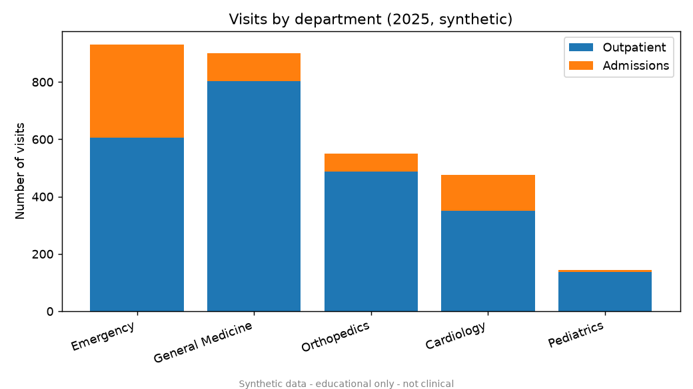
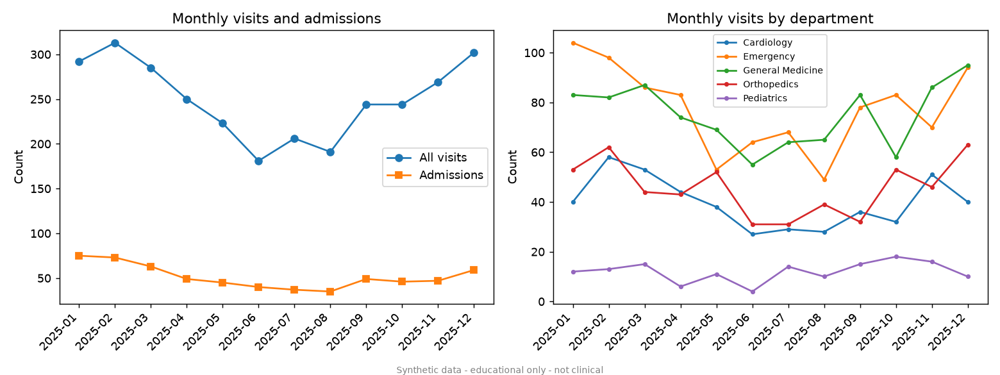
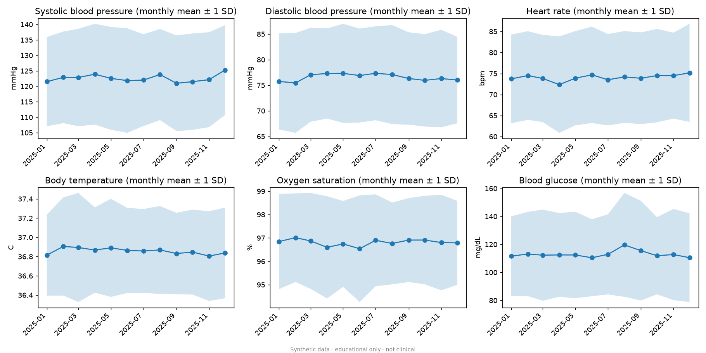
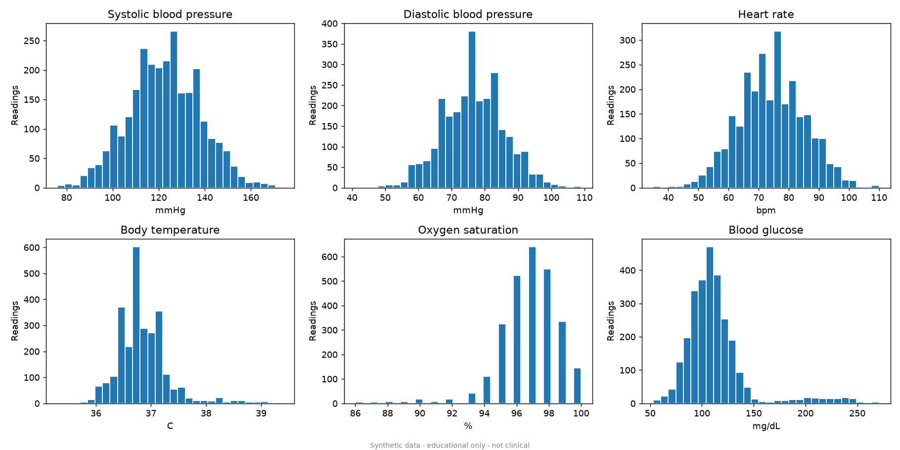
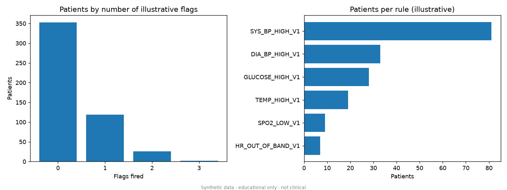

# Operational Analytics Report (synthetic data)

> **EDUCATIONAL ANALYTICS ON SYNTHETIC DATA ONLY. Indicators are illustrative rule outputs, not medical diagnoses, and must not be used for real patient-care decisions.**

## 1. Data overview

- Patients: 500
- Visits: 3000
- Valid measurements: 16403

## 2. Data quality

499 raw readings were rejected during cleaning:

| reason | rows |
|---|---|
| value is missing or not finite | 84 |
| duplicate reading for same patient/date/measure | 82 |
| value # outside plausible range # mmHg | 77 |
| value # outside plausible range # C | 48 |
| value # outside plausible range # bpm | 46 |
| value # outside plausible range # mg/dL | 41 |
| value # outside plausible range # % | 37 |
| unit must be 'mmHg', got 'unknown' | 28 |
| unit must be 'mg/dL', got 'unknown' | 21 |
| unit must be '%', got 'unknown' | 12 |
| unit must be 'C', got 'unknown' | 11 |
| unit must be 'bpm', got 'unknown' | 10 |
| unit must be 'mmHg', got 'unknown'; value is missing or not finite | 1 |
| unit must be 'mmHg', got 'unknown'; value # outside plausible range # mmHg | 1 |

## 3. Department admissions and visits

The busiest department was **Emergency** with 930 visits. The busiest month was **2025-02** with 313 visits.

| department_name | visits | admissions | admission_rate |
|---|---|---|---|
| Emergency | 930 | 324 | 0.348 |
| General Medicine | 901 | 99 | 0.11 |
| Orthopedics | 549 | 62 | 0.113 |
| Cardiology | 476 | 126 | 0.265 |
| Pediatrics | 144 | 7 | 0.049 |

### Monthly trend

| month | visits | admissions |
|---|---|---|
| 2025-01 | 292 | 75 |
| 2025-02 | 313 | 73 |
| 2025-03 | 285 | 63 |
| 2025-04 | 250 | 49 |
| 2025-05 | 223 | 45 |
| 2025-06 | 181 | 40 |
| 2025-07 | 206 | 37 |
| 2025-08 | 191 | 35 |
| 2025-09 | 244 | 49 |
| 2025-10 | 244 | 46 |
| 2025-11 | 269 | 47 |
| 2025-12 | 302 | 59 |

## 4. Measurement summaries and trends

| measure_type | n | mean | std | min | p25 | median | p75 | max |
|---|---|---|---|---|---|---|---|---|
| blood_glucose | 2727 | 113.0 | 31.18 | 53.0 | 96.0 | 108.0 | 121.0 | 271.0 |
| body_temp_c | 2730 | 36.86 | 0.47 | 35.3 | 36.6 | 36.8 | 37.1 | 39.4 |
| diastolic_bp | 2732 | 76.58 | 9.25 | 41.0 | 70.0 | 76.0 | 83.0 | 109.0 |
| heart_rate | 2736 | 74.04 | 10.97 | 35.0 | 66.0 | 74.0 | 81.0 | 110.0 |
| spo2 | 2741 | 96.81 | 1.97 | 86.0 | 96.0 | 97.0 | 98.0 | 100.0 |
| systolic_bp | 2737 | 122.61 | 15.49 | 76.0 | 112.0 | 122.0 | 133.0 | 174.0 |

## 5. Illustrative rule-based indicators

Rules (arbitrary sample thresholds, **not** clinical criteria):

| rule_code | measure_type | description |
|---|---|---|
| SYS_BP_HIGH_V1 | systolic_bp | Latest systolic BP >= 140 mmHg (sample threshold) |
| DIA_BP_HIGH_V1 | diastolic_bp | Latest diastolic BP >= 90 mmHg (sample threshold) |
| HR_OUT_OF_BAND_V1 | heart_rate | Latest heart rate < 50 or > 110 bpm (sample thresholds) |
| TEMP_HIGH_V1 | body_temp_c | Latest body temperature >= 38.0 C (sample threshold) |
| SPO2_LOW_V1 | spo2 | Latest oxygen saturation < 92 % (sample threshold) |
| GLUCOSE_HIGH_V1 | blood_glucose | Latest blood glucose >= 180 mg/dL (sample threshold) |
| FLAG_COUNT_V1 | (all) | Number of rules above that fired for the patient (0 to 6). |

Patients evaluated: 500. Distribution of `FLAG_COUNT_V1` (number of rules fired):

| flag_count | patients | share |
|---|---|---|
| 0 | 353 | 0.706 |
| 1 | 119 | 0.238 |
| 2 | 26 | 0.052 |
| 3 | 2 | 0.004 |

These are counts and distributions only. No clinical validity is claimed.

## 6. Limitations

1. All data is synthetic (generated by a seeded random process). Patterns in it do not describe any real population.
2. Indicators are simple, illustrative rules with arbitrary sample thresholds. They have NOT been clinically validated and are not diagnoses. No treatment advice is given.
3. Rules use only the most recent value of each measurement. They ignore history, symptoms, medications, age-specific norms and clinical context.
4. Counts and distributions only describe this synthetic dataset. They make no claim about sensitivity, specificity or predictive value.
5. Validation ranges are plausibility checks to catch data-entry errors (e.g. a temperature of 986). They are not clinical 'normal' ranges.
6. Access control is a simple API-key scheme for learning purposes. A real health system would need TLS, audit logging, key rotation, consent management and legal review.
7. Nothing here may be used to make real patient-care decisions.
